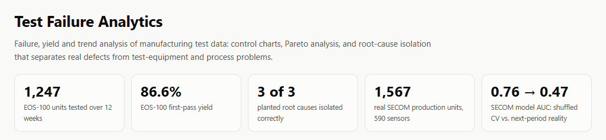
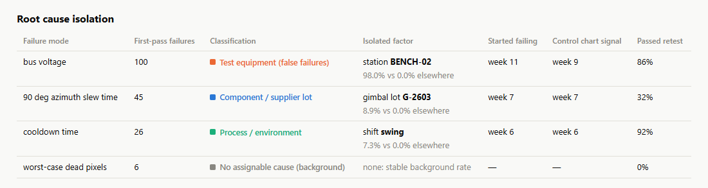
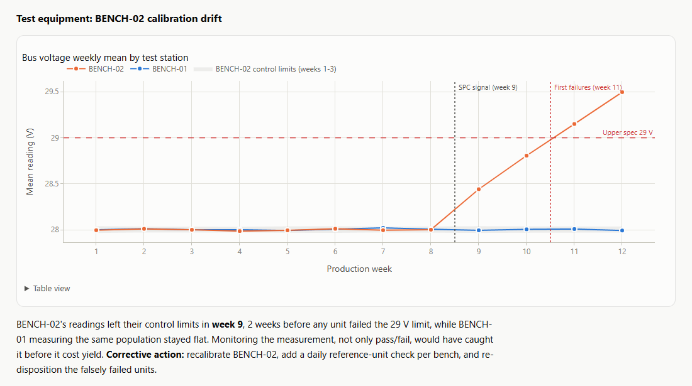
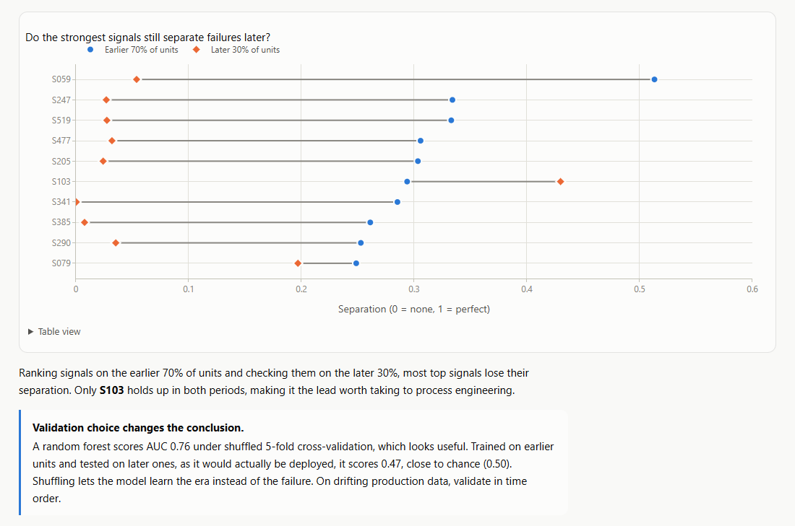
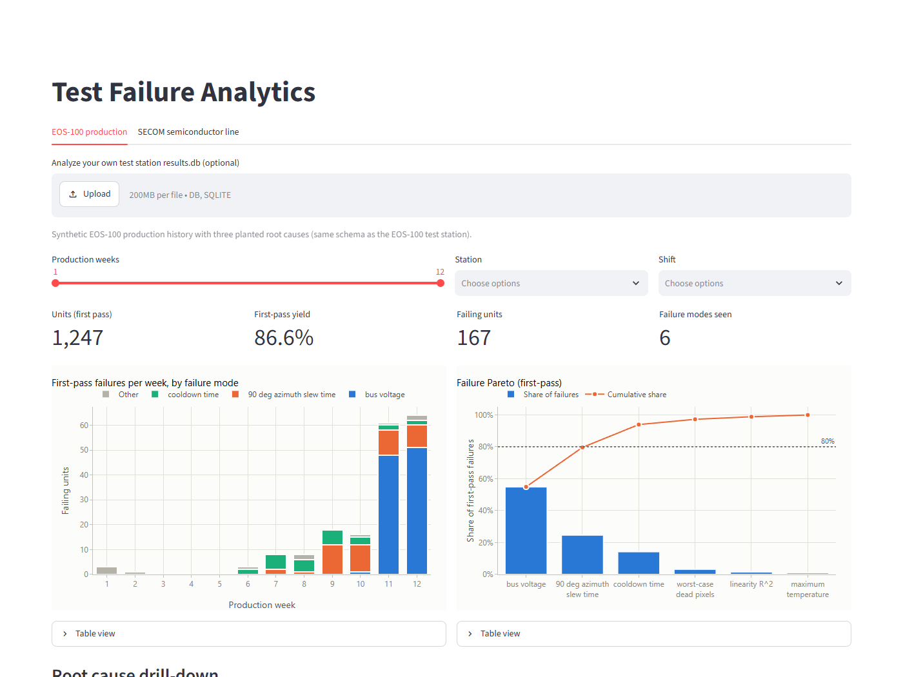

# Test Failure Analytics

[](https://github.com/KyleEGibson/test-failure-analytics/actions/workflows/ci.yml)


Failure, yield and trend analysis of manufacturing test data: control charts (SPC), Pareto analysis, and root cause isolation that tells real defects apart from **test-equipment** and **process** problems.

**[Live report](https://kyleegibson.github.io/test-failure-analytics/)** (rebuilt by CI on every push) · **[8D root cause analysis](docs/root_cause_analysis.md)** · interactive dashboard: `streamlit run app/dashboard.py`



## Two datasets, two lessons

| | Data | What it shows |
|---|---|---|
| **EOS-100 production** | 12 weeks, 1,247 units, in the database schema of my [EOS-100 test station](https://github.com/KyleEGibson/eo-sensor-test-station) | Root-cause isolation, checked against a **known answer**: three causes are planted in synthetic data and the analysis must find them without seeing the answer key |
| **UCI SECOM** | 1,567 real units from a semiconductor line, 590 process sensors, pass/fail | What real, messy, drifting production data can and cannot tell you |

### EOS-100: the Pareto points the wrong way
The biggest failure category (55% of failures) is **not a sensor defect**. 86% of those units passed when retested on the other bench. The analysis isolates each cause correctly:



A control chart on the **raw measurement** caught the drifting test bench in week 9, **two weeks before the first failure**:



**The naive method gets 2 of 3 wrong.** Ranking factors by p-value over the whole history blames a component lot that just happened to be on the line in the same weeks, and an operator who only stands in for their shift. What fixed it:
1. **When did it start?** Onset is the first week that breaks a baseline p-chart.
2. **What changed then?** Factors are screened only within the onset window, Bonferroni-corrected.
3. **Which factor is real?** Stratified chi-square with each other factor held fixed; factors that stop mattering are explained away.
4. **Unit or test?** No-fault-found rate on retest.

A test in the repo (`test_naive_screen_would_have_been_wrong`) keeps this documented.

### SECOM: validation choice changes the conclusion
- **Data quality:** 144 of 590 signals are dropped (28 more than 50% missing, 116 constant), and 10,868 missing values are imputed. Every decision is reported.
- **Yield trend:** the p-chart shows the process was **not stable**. There's a high-failure era in July–August and a lower level from late August.
- **The top signal is a time proxy:** 25 signals pass a false-discovery-rate test, but the strongest, S059, tracks *which era* a unit came from. Checked on later units, it loses its separation. Only **S103** holds up in both periods.
- **Model validation:**

  | Validation method | AUC |
  |---|---|
  | Shuffled 5-fold cross-validation | **0.76** (looks useful) |
  | Train on earlier units, test on later ones | **0.47** (chance) |

  Shuffling lets the model learn the era instead of the failure.



## Interactive dashboard
Filters, a root-cause drill-down per failure mode, and **upload of any test station `results.db`**. It works on databases straight from the EOS-100 test station, which have no lot data.



## What this demonstrates
| Job requirement | Where |
|---|---|
| Failure and trend analysis | `eos.py` (onset, factor isolation), `spc.py`, p-charts, X-bar early warning |
| Root cause analysis and corrective action | [`docs/root_cause_analysis.md`](docs/root_cause_analysis.md) (8D, fishbone, 5 Whys) |
| SQL | [`src/failure_analytics/sql/`](src/failure_analytics/sql): window functions, CTEs, joins to manufacturing records |
| Statistics | Western Electric rules, Cpk, chi-square and stratified tests, Mann-Whitney U, Benjamini-Hochberg FDR |
| Data cleaning and validation | Auditable SECOM cleaning, checksum-pinned source data, chronological validation |
| Dashboards and reporting | Static Plotly report (light/dark, table view per chart), Streamlit app |
| Testing | 49 pytest tests: SPC math vs hand calculations, known-answer tests, SQL cross-checked against pandas, headless dashboard tests |

## Quick start
```bash
python -m venv .venv
.venv\Scripts\activate                       # Windows  (source .venv/bin/activate elsewhere)
pip install -e ".[dev,dashboard]"
pytest                                       # 49 tests, about 15 s
python -m failure_analytics report --out site   # site/index.html
python -m failure_analytics analyze             # findings in the terminal
python -m failure_analytics analyze --db path/to/results.db   # any test station database
streamlit run app/dashboard.py
```

## Layout
```
data/raw/secom.zip              UCI SECOM (CC BY 4.0), SHA-256 pinned
src/failure_analytics/
  secom.py                      load, clean, time split
  spc.py                        I-MR, p-chart, Western Electric rules, Cpk
  signals.py                    signal ranking, FDR, stability, CV comparison
  eos_generator.py              synthetic production history (answer key in the docstring)
  eos.py                        onset, factor screen, stratified isolation, retest, X-bar
  sql/                          the queries behind the EOS analysis
  charts.py, report.py          Plotly figures and the static report
app/dashboard.py                Streamlit dashboard
docs/root_cause_analysis.md     8D report
tests/                          SPC, signals, EOS known answers, report, dashboard
```

## Defects found while building it
Each is described in its commit message.

| Symptom | Root cause | Fix |
|---|---|---|
| Every FDR q-value became NaN | One untestable signal's NaN p-value spread through Benjamini-Hochberg | Exclude NaN p-values from the test count; regression test |
| Root cause blamed on the wrong factor (2 of 3) | Whole-history p-value ranking is fooled by time-correlated and nested factors | Onset window + stratified chi-square |
| Report charts blank | Plotly loaded after the inline chart scripts | Load in `<head>`; test checks the order |
| Trend paragraph didn't match the chart | Written by hand from the daily analysis; the chart is weekly | Narrative generated from the rule violations |
| Retest pass rate 82% in the report, 86% in SQL | Different denominators (failed vs. actually retested units) | Retested units everywhere; regression test |
| Dashboard crashed comparing readings by station | Duplicate `station` column after a merge | Caught by the headless `AppTest`, not visible in a screenshot |

Data: McCann, M. & Johnston, A. (2008). SECOM. UCI Machine Learning Repository. https://doi.org/10.24432/C54305 (CC BY 4.0).
